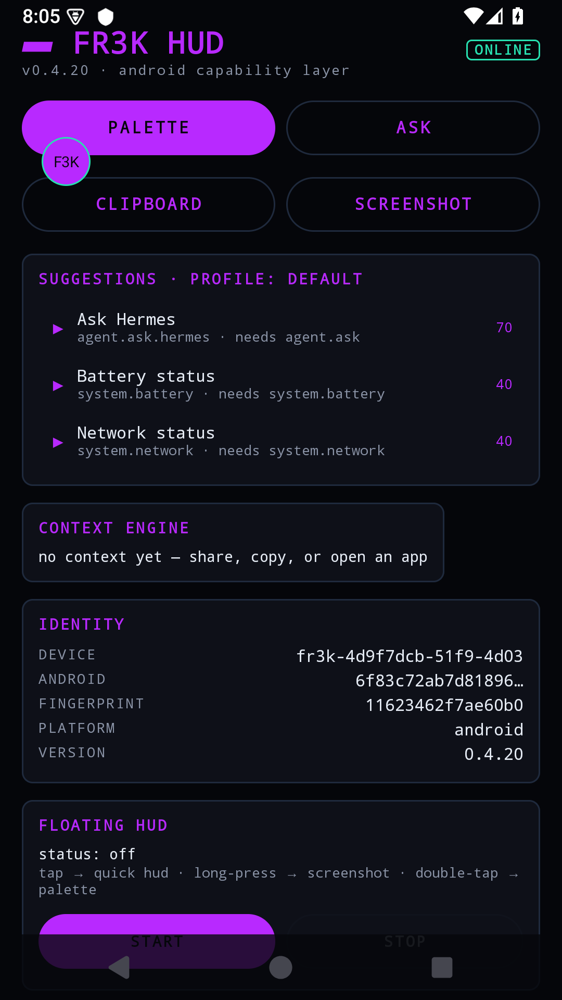
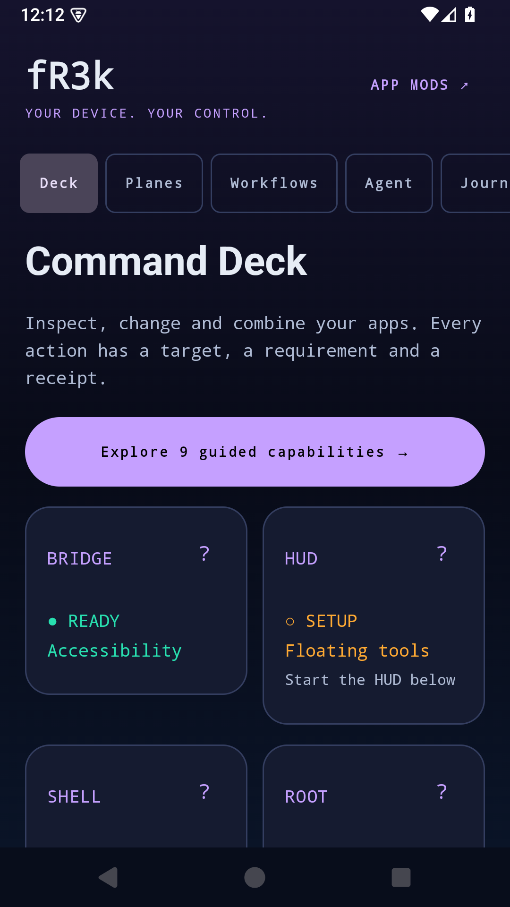
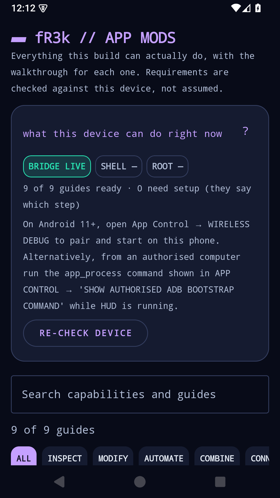

# Before and after — development evidence

Development comparison, not a release-acceptance certificate. Per-measurement detail, evidence paths and
the honest list of what is *not* verified live in [VERIFICATION-REPORT.md](VERIFICATION-REPORT.md); the
active work order is [CONTINUATION.md](CONTINUATION.md).

| Previous dashboard | Redesigned Command Deck | APP MODS (guides + readiness) |
|---|---|---|
|  |  |  |

Screenshots recaptured from the 0.4.21 debug build on `emulator-5582` after the final device run. The Deck
shows live readiness (BRIDGE READY, HUD SETUP, SHELL, ROOT); APP MODS reports "9 of 9 guides ready · 0 need
setup" with the same readiness badges and the category filters.

The new Deck groups live readiness, workflows, agent access and receipts into six persistent tabs. APP MODS
is a permanent entry point with search, category filters, prerequisite badges and limits/undo explanations.
The production guide catalogue describes **selected installed apps** — inspection, controls, maps,
workflows, patching, wireless shell, root, provider and MCP — and fixture walkthroughs appear only in the
instrumented capability lab, which is debug-only and off by default.

| Measure | Observed result | Practical limit |
|---|---|---|
| JVM regression suites (`capability`, `core`, `app`, `patch-fixture`, `protocol`, `transport`) | **322 tests, 0 failures** | Proves logic, not UI or hardware behaviour |
| Accessible name + containment, every rendered clickable control, 10 screens | **PASS** at current scale and at **200% font** | No TalkBack speech traversal (not installed) |
| Reduced motion (animations disabled) | Floating tools still work — `OK (2 tests)` | Covers the shared floating surfaces, not every animation |
| Cold start | **1569 ms** | Debug build with the test harness installed |
| Frame timing while scrolling | **252 frames, 110 janky, p90 65 ms** | SwiftShader software rendering — not a device frame-rate claim |
| Memory footprint | **TOTAL PSS 191052 kB** | Single scenario, not a soak test |
| Production UI + live integrations, one class per process | **20 tests in 6 classes, 0 failures, 0 crashes** | Emulator; live AI calls need a real key on the device |
| Real third-party app through the product surface | Termux: **8 screen controls mapped**, **49 capabilities** over MCP, selection removable | System apps are refused as mapping targets by design |
| Capability lab, four planes (bridge / patch / shell UID2000 / root UID0) | **PASS**, companions uninstalled (`[]`) | Emulator only; the same planes on hardware still need a physical run |
| Controlled palette contrast | 41 pairs AA, minimum 5.28:1 | Not a rendered-pixel audit of every surface |
| Real wireless pairing/start/shutdown/reconnect and selected-app controls | `OK (2 tests)` | Backend test duration, not human pairing task time |
| Live OpenCode Go health + real tool-call round trip | `OK` | Real network; `/responses` and `/messages` models excluded (cannot carry tool calls) |

Defects found by the new accessibility lab and fixed rather than documented away: seven unnamed clickable
rows; Settings' provider-preference row clipping its third option at every font scale; and a family of
200%-font layout collapses where a control beside a text column wrapped its label vertically until it was
clipped and unnamed (Blackwave header and OTA / LIVE APPLY actions).

Not completed, and therefore not claimed: a human comprehension study, before/after task-time comparison,
TalkBack speech traversal, and release-signed performance measurement. External hardware and direct peer
transport cannot be validated by this emulator.
